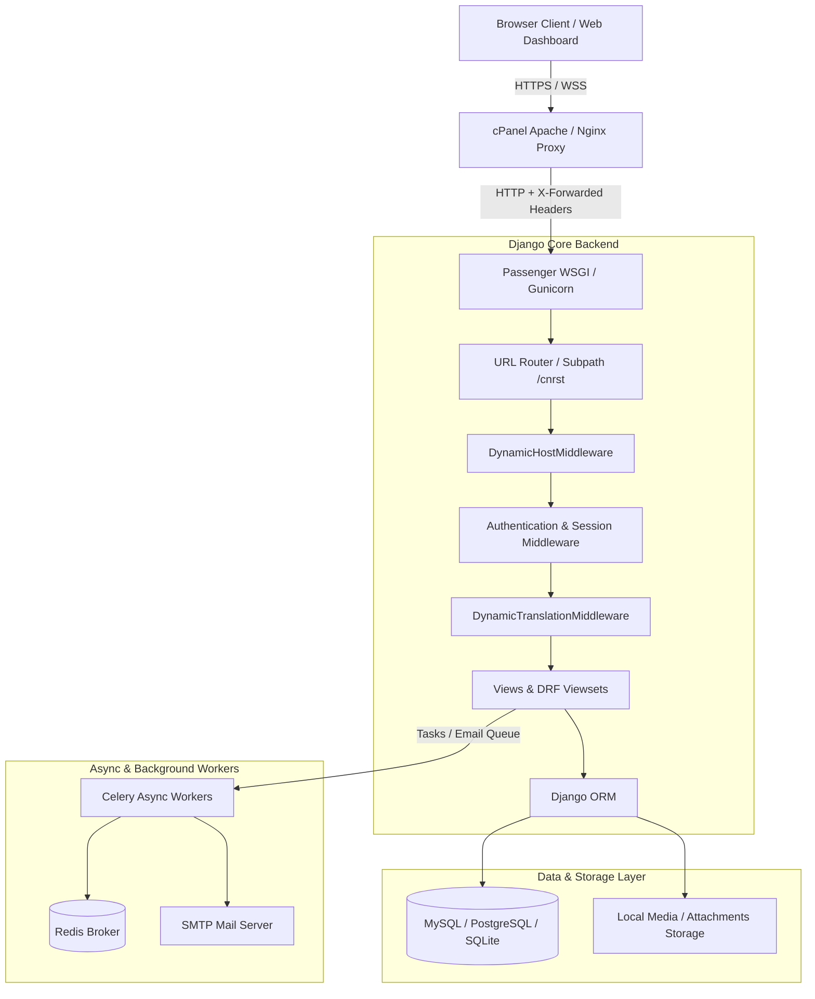
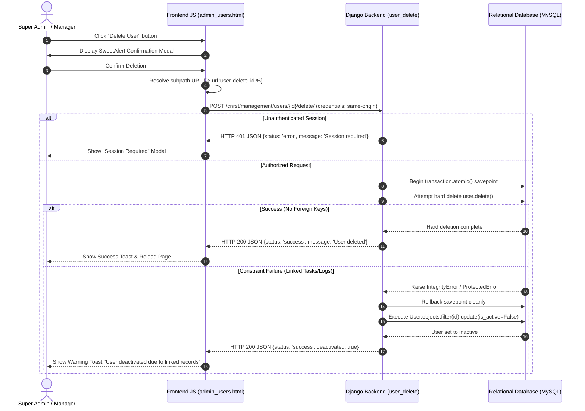
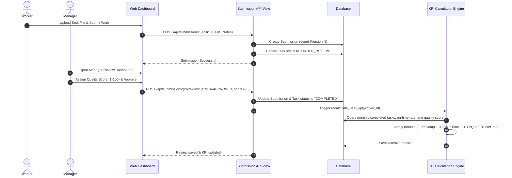
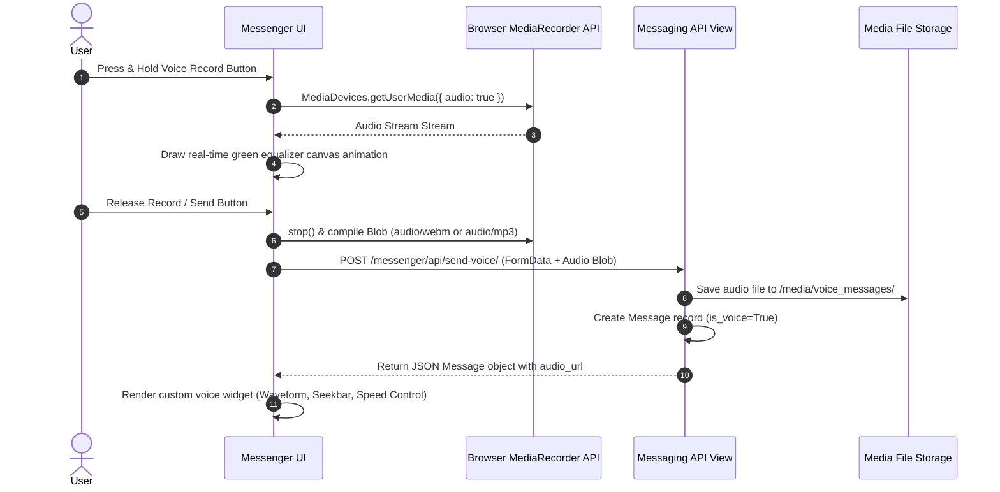
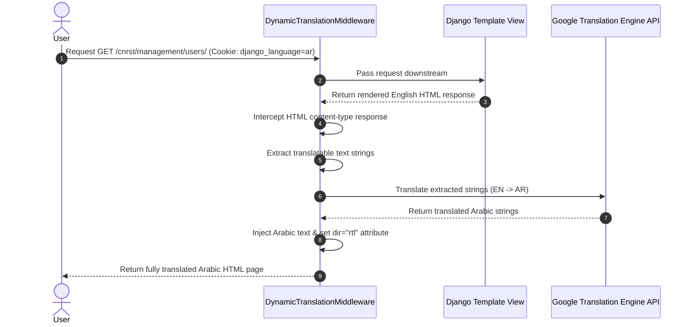

# WorkTrack Pro (DEGHA NOVA) - Enterprise KPI & Workforce Management System

An enterprise-grade, multi-role workforce performance management, task workflow, dynamic localization, real-time messaging, and KPI analytics platform built on **Django**, **Django REST Framework**, **Celery**, and **Vanilla JS / Modern CSS**.

---

## 🌟 Executive System Overview

WorkTrack Pro provides organizations with end-to-end operational governance. Designed to deploy seamlessly in multi-tenant or single-tenant production environments (including cPanel/Passenger WSGI subpath setups like `/cnrst`), the platform automates task distribution, submission versioning, dynamic translation, real-time messaging with embedded voice equalizer widgets, and automatic multi-weighted KPI calculation.

---

## 🛠️ Technology Stack

| Layer | Technologies & Frameworks |
| :--- | :--- |
| **Backend Core** | Python 3.13, Django 5.x, Django REST Framework (DRF), SimpleJWT |
| **Database Support** | MySQL (PyMySQL), PostgreSQL (`psycopg2`), SQLite (Local Dev) |
| **Asynchronous Engine** | Celery 5.x, Redis, Django-Celery-Beat |
| **Frontend & UI** | Vanilla JS (ES6+), Bootstrap 5, FontAwesome, SweetAlert2, HTML5 Canvas Equalizers |
| **Localization** | `DynamicTranslationMiddleware`, Google Free Translate Engine API |
| **Asset Pipeline** | WhiteNoise Static Storage, HTML Canvas Waveforms, HTML Audio APIs |
| **Production WSGI** | Phusion Passenger, Gunicorn, Nginx / Apache Reverse Proxies |

---

## 🏗️ High-Level System Architecture



---

## 📋 Comprehensive Feature Modules

### 1. User Command Center & Management
- **Role-Based Access Control (RBAC)**: Super Admin, Manager, and Worker tiers.
- **Atomic Deletion & Soft-Deactivation**: Safe account removal wrapped in `transaction.atomic()` savepoints. If linked records exist (`Task`, `Submission`, `ActivityLog`), the system falls back to `is_active=False` soft deactivation without breaking database constraints.
- **Subpath Cookie Isolation**: Custom cookie naming (`cnrst_sessionid`, `cnrst_csrftoken`) with `credentials: 'same-origin'` for cPanel subpath deployment.

### 2. Task Management, Kanban & Calendar
- **Full Task Lifecycle**: Creation, priority scoring, tag assignment, worker allocation, and cover/attachment management.
- **Interactive Views**: Standard table view, drag-and-drop Kanban board, and monthly calendar schedule.
- **Bulk Operations**: Multi-task assignment, status updating, and CSV exporting.

### 3. Submission Engine & Version Control
- **File Attachments & Comments**: Multi-version task submissions with interactive document preview.
- **Review & Approval**: Manager feedback loops, rating assignments, and on-time status tagging.

### 4. Automated KPI Engine
- **Multi-Factor Formula**:
  $$\text{KPI Score} = (0.25 \times \text{Completion}) + (0.25 \times \text{OnTime}) + (0.30 \times \text{Quality}) + (0.20 \times \text{Productivity})$$
- **Recalculation Pipeline**: Automatic weight configuration and batch history calculation.

### 5. Messenger & Glassmorphic Voice Interface
- **Real-Time Communication**: Group and 1-on-1 instant messaging with interactive polling.
- **Voice Message Studio**: Glassmorphism recording bar featuring dynamic green HTML5 canvas audio equalizer and custom seekable voice player widgets (1x / 1.5x / 2x speed controls).

### 6. Dynamic Localization Engine
- **Bilingual Interface (EN / AR)**: Auto-translates template rendered strings on-the-fly via `DynamicTranslationMiddleware`.
- **RTL / LTR Support**: Instant switching of directionality and language state.

---

## 🔄 System Workflows & Sequence Diagrams

### Workflow 1: User Management & Safe Deletion Workflow



---

### Workflow 2: Task Submission Lifecycle & KPI Scoring



---

### Workflow 3: Voice Message Recording & Equalizer Playback



---

### Workflow 4: Dynamic Subpath Localization Middleware



---

## 🚀 Production cPanel Deployment Guide

### 1. Reverse Proxy SSL Header Configuration (`settings.py`)
Ensure your `settings.py` includes reverse proxy SSL headers for cPanel's Apache/Nginx to Passenger proxying:
```python
USE_X_FORWARDED_HOST = True
USE_X_FORWARDED_PORT = True
SECURE_PROXY_SSL_HEADER = ('HTTP_X_FORWARDED_PROTO', 'https')
```

### 2. Cookie Isolation for Subpath (`/cnrst/`)
When deploying under a subpath like `https://dhetasks.com/cnrst`:
```python
FORCE_SCRIPT_NAME = '/cnrst'
SESSION_COOKIE_PATH = '/cnrst/'
CSRF_COOKIE_PATH = '/cnrst/'
SESSION_COOKIE_NAME = 'cnrst_sessionid'
CSRF_COOKIE_NAME = 'cnrst_csrftoken'
```

### 3. SMTP Email Configuration
- **Port 465 (Implicit SSL)**:
  ```ini
  EMAIL_PORT=465
  EMAIL_USE_SSL=True
  EMAIL_USE_TLS=False
  ```
- **Port 587 (STARTTLS)**:
  ```ini
  EMAIL_PORT=587
  EMAIL_USE_TLS=True
  EMAIL_USE_SSL=False
  ```

---

## 📁 Project Directory Structure

```
DEGHA NOVA/
├── docs/                   # Complete project documentation, guides, and reports
│   ├── DOCUMENTATION_INDEX.md # Master documentation index
│   ├── guides/             # User, developer, API, and setup guides
│   ├── reports/            # System audits, milestone reports, and completion summaries
│   └── prototypes/         # HTML design prototypes and mockups
├── scripts/                # Project automation, database, and maintenance scripts
│   ├── database/           # DB seed scripts, demo data, and translation tools
│   ├── maintenance/        # UI/CSS patches, template repairs, and maintenance tools
│   ├── deployment/         # Server deployment, cPanel, macOS, and update scripts
│   └── utils/              # Verification utilities and asset helpers
├── tests/                  # Automated test suite and test verification scripts
├── backup/                 # Database backups and configuration snapshots
├── logs/                   # Server logs, test outputs, and worker logs
├── tmp/                    # Temporary rendering and scratch files
├── comit/                  # Feature planning and architectural design logs
├── worktrack_pro/          # Django core project configuration (settings, urls, wsgi)
├── worktrack-pro/          # Frontend application workspace
├── [apps]/                 # Django apps (users, tasks, submissions, kpi, etc.)
├── static/ & media/        # Static assets and uploaded media files
├── manage.py & manage.sh   # Main Django CLI and interactive management scripts
├── menu.sh                 # Quick interactive menu runner
├── activate.sh             # System security activation & environment script
└── requirements.txt        # Python dependency manifest
```

---

## 💻 Local Development Setup

```bash
# Clone project and navigate to folder
cd "DEGHA NOVA"

# Create virtual environment & activate
python3 -m venv .venv
source .venv/bin/activate

# Install dependencies
pip install -r requirements.txt

# Run migrations & check system
python manage.py check
python manage.py migrate

# Start development server
python manage.py runserver 0.0.0.0:8000
```

---

**WorkTrack Pro (DEGHA NOVA)** — Built for Enterprise Excellence.
