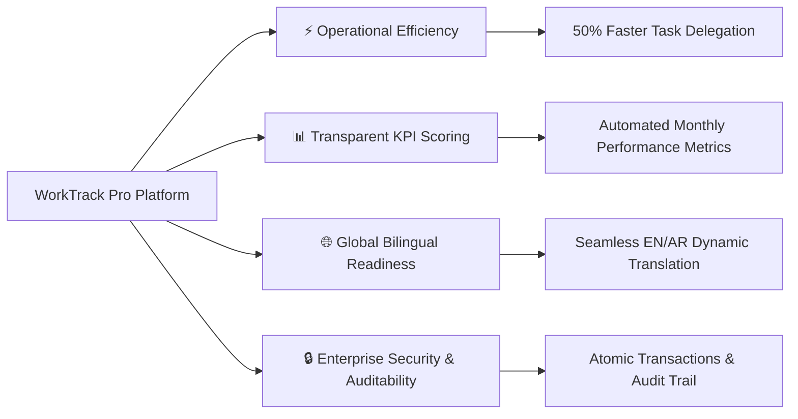
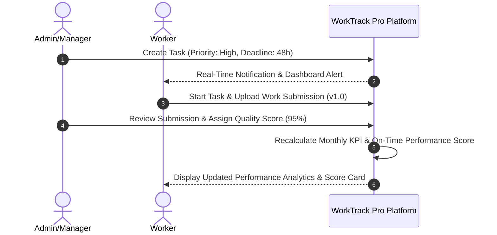

# 🚀 WorkTrack Pro (DEGHA NOVA) - Enterprise Platform Presentation

### Next-Generation Workforce Governance, Automated KPI Analytics & Real-Time Communication

---

## 💎 Executive Summary

**WorkTrack Pro (DEGHA NOVA)** is a state-of-the-art enterprise workforce management platform engineered to streamline organization-wide task distribution, automate multi-factor performance metrics (KPIs), and foster real-time collaboration.

By unifying task scheduling, version-controlled submissions, dynamic bilingual localization, audio-enhanced messaging, and operational auditing into a single cohesive ecosystem, WorkTrack Pro empowers enterprises to achieve **100% operational transparency and peak workforce productivity**.

---

## 🏆 Key Client Value Propositions

---

## 🎯 Key Feature Showcase & Core Pillars

### 👑 1. Command Center & Workforce Management
- **Role-Based Access Control (RBAC)**: Tailored dashboards for **Super Admins**, **Managers**, and **Workers**.
- **User Management Suite**: Real-time role assignment, department mapping, and supervisor hierarchy.
- **Fail-Safe User Account Deletion**: Safe atomic deletion (`transaction.atomic()`) with automatic soft-deactivation fallback to protect historical task and audit logs.

### 📋 2. Intelligent Task Orchestration & Submissions
- **Multi-View Task Center**: Switch effortlessly between standard Data Tables, visual **Kanban Boards**, and interactive **Calendar Schedules**.
- **Task Enrichment**: Attach cover images, priority badges, tags, and multi-file attachments.
- **Submission Versioning**: Workers submit completed assignments with version history and comment threads. Managers review, score quality (1-100), and provide feedback.

### 📈 3. Automated KPI Engine & Analytics
- **Dynamic Multi-Weighted Scoring**: Automatically calculates monthly performance scores based on four core pillars:
  $$\text{KPI Score} = \underbrace{(25\% \times \text{Completion})}_{\text{Task Output}} + \underbrace{(25\% \times \text{On-Time})}_{\text{Punctuality}} + \underbrace{(30\% \times \text{Quality})}_{\text{Manager Rating}} + \underbrace{(20\% \times \text{Productivity})}_{\text{Speed}}$$
- **Executive Dashboards**: Real-time leaderboard charts, worker performance metrics, and automated CSV export reporting.

### 🎙️ 4. Next-Gen Messenger & Voice Studio
- **Glassmorphic Voice Recorder**: Record voice notes directly within the chat interface using a glowing HTML5 canvas audio equalizer.
- **Custom Voice Audio Player**: Interactive waveform audio widget supporting scrub seeking, duration tracking, and playback speed control (**1x**, **1.5x**, **2x**).
- **Interactive Polling & Chat**: Create live team polls, send file attachments, and broadcast team announcements.

### 🌐 5. Dynamic Bilingual Localization (English & Arabic)
- **Instant Language Switching**: Dynamic, on-the-fly translation powered by intelligent middleware.
- **RTL / LTR Adaptive Layout**: Automatic alignment and layout flipping for right-to-left (Arabic) and left-to-right (English) interfaces.

### 🗺️ 6. Offline Map Hub & Spatial Intelligence
- **Offline Map Tile Proxy**: Stream spatial map tiles locally without relying on external internet connectivity.
- **Geographic Task Mapping**: Visualize global team locations and field assignments on an interactive map dashboard.

---

## 🔄 User Journey & Feature Flowchart

---

## 📊 Business ROI & Operational Impact

| Feature Domain | Traditional Manual Workflow | WorkTrack Pro Automated Ecosystem | Impact / Client Benefit |
| :--- | :--- | :--- | :--- |
| **Task Delegation** | Scattered emails & spreadsheets | Centralized Task Center & Kanban Board | **70% Time Reduction** in task tracking |
| **Performance Evaluation** | Subjective annual reviews | Real-time automated weighted KPI engine | **100% Objective & Fair** performance metrics |
| **Team Communication** | Third-party chat apps | Integrated Messenger with Voice Studio | **Enhanced Security & Accountability** |
| **Multilingual Support** | Separate localized web apps | Dynamic Middleware EN/AR Translation | **Zero Overhead** for international deployment |
| **Data Integrity** | Prone to accidental data loss | Atomic Database Transactions & Audit Logs | **Enterprise Compliance Ready** |

---

## 🛡️ Enterprise Security & Technical Guarantee

- **Bank-Grade Authentication**: JWT & Session Token Security with strict role permissions.
- **Atomic Database Integrity**: Safe transactions ensuring data auditability even during user deactivation.
- **cPanel & Cloud Production Ready**: Pre-configured for subpath SSL reverse proxies (`/cnrst`), automated static caching (WhiteNoise), and Redis background task queuing.

---

### 📞 Contact & System Demonstration

Ready to transform your workforce management? Contact our engineering team for a live demonstration of **WorkTrack Pro (DEGHA NOVA)**.

- **System Version**: v1.0 Enterprise Edition
- **Platform Architecture**: Django / Celery / Modern ES6 UI
